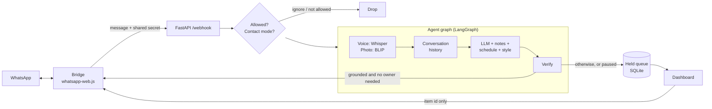

# WhatsApp Assistant Agent

An AI assistant that answers my WhatsApp messages in my own voice (Egyptian Arabic, Franco-Arabic and English),
**and holds anything it isn't sure about for my approval instead of guessing.**

> The goal is not "reply to everything". It is: **never say something I wouldn't say.**

<!-- Add a short demo here:  -->

## Contents
- [What it does](#what-it-does)
- [How a message is decided](#how-a-message-is-decided)
- [Architecture](#architecture)
- [The dashboard and Arianna](#the-dashboard-and-arianna)
- [Safety design](#safety-design)
- [Privacy and data flow](#privacy-and-data-flow)
- [Setup](#setup)
- [Configuration](#configuration)
- [Tests and evaluation](#tests-and-evaluation)
- [Deploying with Coolify](#deploying-with-coolify)
- [Project structure](#project-structure)
- [Troubleshooting](#troubleshooting)
- [Known limits](#known-limits)
- [Roadmap](#roadmap)

## What it does

**On WhatsApp**
- Replies to incoming messages in my writing style (short, casual, feminine forms, no punctuation), matching the sender's language and script.
- Answers questions about my work and schedule **only from facts I wrote down** (`data/kb/about_me.md`), such as what I do, what projects I take, and where I am at a given time.
- Understands **voice notes** (faster-whisper) and **photos** (BLIP captions), and reacts like a friend would.
- **Holds** anything uncertain, personal, or a commitment (invitations, "confirm", "pay") for my approval, and shows me why.
- Optionally retrieves similar past replies from my own chat exports, so the tone stays close to how I really write.

**In the dashboard** (a web page I open from my laptop or phone)
- Approve, edit, send or dismiss held replies.
- Pause all auto-replies with one switch, or set any contact to *reply automatically*, *always ask me first*, or *ignore*.
- Chat with **Arianna**, a dashboard assistant that can send messages, draft messages, send my location, and list or read out the messages I received.
- Talk to Arianna: dictate, say the wake word, and hear answers spoken back.
- Browse a message history and an activity log.

## How a message is decided

One model call returns the reply plus two flags. The decision to send is plain code, not model judgment:

```text
send automatically  =  reply is not empty  AND  grounded  AND  NOT needs_owner
```

| Flag | Meaning |
|---|---|
| `grounded` | Every fact in the reply comes from the prompt: my notes, my schedule, the current time, or the conversation. False if the model had to guess anything about me. |
| `needs_owner` | Only I can answer: a decision, private information, a detailed project discussion, a complicated technical issue, or any invitation or request to attend, confirm, promise or pay. |

When there is doubt, the default is **hold**. Reasons shown in the dashboard:

| Reason | Cause |
|---|---|
| Needs you to answer | `needs_owner` was true |
| May contain a fact it wasn't sure about | `grounded` was false |
| The model gave no usable answer | Empty or malformed output (fails closed) |
| Auto-reply was paused | The global kill switch is on |
| This contact is set to always ask you first | Per-contact mode |

The two flags are self-reported by the model, so they are a signal, not a guarantee. That is why there is an
[evaluation set](#tests-and-evaluation) that checks what actually gets sent.

## Architecture



| Part | Role |
|---|---|
| **Bridge** (`whatsapp-bridge/`) | A thin Node layer that receives messages and sends replies. Resolves privacy `@lid` ids to phone numbers. Its send API listens on `127.0.0.1` only and needs a shared secret. |
| **Agent** (`app/agent_graph.py`, `app/llm.py`) | LangGraph pipeline: resolve voice or image to text, load history, generate the JSON answer, verify. |
| **Backend** (`app/main.py`) | FastAPI webhook, allowlist, contact modes, kill switch, message log. |
| **Dashboard** (`app/dashboard.html`, `dashboard.py`, `assistant.py`, `controls.py`, `approvals.py`) | Login, held queue, controls, Arianna, messages, activity. |

## The dashboard and Arianna

| Tab | Purpose |
|---|---|
| **Chat** | Talk to Arianna by typing, dictating or voice |
| **Held** | Replies waiting for approval, each with its reason. Edit, send or dismiss |
| **Messages** | Received and sent messages, filtered by contact, day and direction. No AI involved |
| **Activity** | An audit log of automatic replies, holds, approvals and setting changes |
| **Contacts** | Per-contact mode: automatic, always ask me first, or ignore |

Header switches: **Auto-reply** (kill switch), **Direct send**, **Voice chat**, and **Say Arianna** (hands-free).

**Things you can say to Arianna** (Arabic or English):
- "tell Mom I'm on my way" sends immediately when Direct send is on.
- "write a message to Mom saying I'll be late" shows a draft to review.
- "who messaged me today?" lists and reads out each message with the sender's name.
- "what did Mom send today?" does the same for one contact.
- "send my location to Mom" sends the position of the device the dashboard is open on.

**Voice**
- *Dictation:* faster-whisper on the server, with automatic Arabic or English detection.
- *Spoken replies:* free Microsoft voices (edge-tts) by default, or an instructable OpenAI voice with `TTS_PROVIDER=openai` (needs its own `OPENAI_API_KEY`; it falls back to the free voice if that fails).
- *Wake word* ("Arianna"): uses the browser's speech service in Chrome or Edge; the question itself is transcribed by Whisper.
- An animated orb shows when Arianna is listening, thinking or speaking.

Listing messages is a database query: **the model never reads message contents and it costs no tokens**. The page reads them aloud itself.

## Safety design

| Risk | Decision |
|---|---|
| The model invents a fact | Facts may only come from `about_me.md` and the schedule. Malformed or missing flags fail closed into a hold. |
| The model grades its own answer | The flags are measured against an evaluation set rather than trusted. |
| A contact's message tries to instruct the assistant | The dashboard assistant never sees incoming chats, so contacts cannot reach its tools. |
| The browser is used to message arbitrary numbers | Dashboard sends are limited to names in `contacts.json`. Approving a held reply sends only an item id; the chat id comes from the database. |
| A reply is sent twice | Held items move `pending → sending → sent` in one atomic SQL update. |
| Someone finds the tunnel URL | Password login, signed `HttpOnly` `SameSite=Strict` cookie, per-IP lockout. `/webhook` requires the bridge secret. The bridge listens on localhost only. |
| Direct send commits me to a wrong message | It can be switched off. Only exact names from `contacts.json` are valid, and the sent text is shown (and read back after a spoken request). |
| Logs leak private chats | Structured logs hold flags, sizes and an anonymised chat id, never message text, numbers or coordinates. |

## Privacy and data flow

| Data | Where it goes |
|---|---|
| Incoming message text, my notes, schedule, recent conversation | **Claude API** (to write the reply) |
| Voice notes, photos, embeddings | Processed **locally** (faster-whisper, BLIP, sentence-transformers) |
| Held replies, conversation memory, message history, audit log | **Local SQLite** (`data/assistant.db`). Message history is deleted after `MESSAGE_RETENTION_DAYS` (default 30) |
| Arianna's spoken replies (text only) | Microsoft's online voice service (edge-tts), or OpenAI if `TTS_PROVIDER=openai` (the only part that talks to OpenAI) |
| Microphone audio for the wake word | The browser's speech service (Chrome or Edge), **only while "Say Arianna" is on** |

Only chosen contacts are answered (`ALLOWED_CONTACTS`). Anyone talking to the assistant is talking to software that
imitates me, so I keep it for practical messages and hold personal ones.

## Setup

**Requirements:** Python 3.11 or 3.12 (`torch` has no 3.13+ wheels), Node.js 20+, an Anthropic API key, and an HTTPS tunnel (such as Cloudflare Tunnel or
ngrok) if you want the microphone or location in the dashboard from another device.

```bash
# backend  (3.12 here; torch has no wheels past 3.12)
python3.12 -m venv venv && source venv/bin/activate   # Windows: venv\Scripts\activate
pip install -r requirements.txt

# bridge
cd whatsapp-bridge && npm install && cd ..

# configuration
cp .env.example .env            # then fill in ANTHROPIC_API_KEY and ALLOWED_CONTACTS,
                                # and generate DASHBOARD_PASSWORD + BRIDGE_API_TOKEN
```

1. **`contacts.json`** (project root) maps a name to a phone number or chat id: `{"Mom": "201012345678"}`.
2. **`data/kb/about_me.md`**: your facts. Keep the sections `## Schedule` and
   `## Things to redirect rather than answer directly`; the assistant uses them literally.
   It ships with the headings and nothing under them, because everything in it is given to the
   model as true: an empty section makes the assistant say it isn't sure, a guessed one makes it
   state something false in your name. `data/kb/FILL_THIS_IN.md` (never read by the app) says
   what belongs in each section.
3. **`data/style_examples.md`**: short lines in your own voice, one per `-` bullet, grouped by situation.
4. *(optional)* Build the style index from a WhatsApp chat export (`app/export_parser.py` parses it into reply pairs).
   Without `data/style_index/` this step is simply skipped.

```bash
uvicorn app.main:app --port 8000        # 1. start the backend first
cd whatsapp-bridge && npm start         # 2. then the bridge, and scan the QR code once
```

Open `http://localhost:8000/dashboard` (or your tunnel URL) and sign in with `DASHBOARD_PASSWORD`.
Both programs must be running for auto-replies; listing stored messages and chatting with Arianna work with the backend alone.

## Configuration

Copy `.env.example` and set at least the **bold** values.

| Variable | Purpose |
|---|---|
| **`ANTHROPIC_API_KEY`**, `ANTHROPIC_MODEL` | Model used for replies and for Arianna (default `claude-opus-5-5`) |
| `ANTHROPIC_EFFORT` | Thinking depth and token spend: `low`, `medium` (default), `high`, `xhigh`, `max`. Raise it if the evaluation set shows unsafe sends |
| `ANTHROPIC_MAX_TOKENS` | Ceiling for one reply (default 4096). Thinking tokens come out of it, so keep it well above the reply length |
| `USER_NAME` | Name the assistant answers to when someone calls you |
| **`DASHBOARD_PASSWORD`** | Dashboard login. Use a long random value: `python -c "import secrets; print(secrets.token_urlsafe(32))"` |
| `TRUST_PROXY` | `true` if behind a tunnel, so lockouts use the real client IP |
| **`BRIDGE_API_TOKEN`** | Shared secret between bridge and backend (both directions) |
| `BRIDGE_API_URL`, `BRIDGE_API_PORT`, `BACKEND_URL` | Where the two programs find each other |
| **`ALLOWED_CONTACTS`** | Comma-separated phone numbers that get answered. Empty means everyone, so set it before going live |
| `ALLOW_GROUPS` | Answer group chats (default `false`) |
| `WHISPER_MODEL_SIZE`, `DASHBOARD_WHISPER_SIZE` | Model size for voice notes and for dashboard dictation |
| `TTS_PROVIDER` | `edge` (free) or `openai` (an instructable, more Egyptian-sounding voice, paid per use) |
| `OPENAI_API_KEY`, `OPENAI_TTS_VOICE`, `OPENAI_TTS_STYLE`, `OPENAI_TTS_MODEL` | Only for `TTS_PROVIDER=openai`. Claude has no speech endpoint, so this one voice keeps its own key |
| `DASHBOARD_VOICE_AR`, `DASHBOARD_VOICE_EN` | edge-tts voices |
| `ASSISTANT_NAME` | Arianna's name (also edit the wake-word spellings in `dashboard.html`) |
| `MESSAGE_RETENTION_DAYS` | How long message history is kept (default 30) |
| `REPLY_WITH_VOICE` | Send voice replies on WhatsApp for voice notes (default `false`) |
| `STYLE_RETRIEVAL`, `EMBEDDING_MODEL` | Retrieval of similar past replies |

## Tests and evaluation

```bash
pip install -r requirements-dev.txt # pytest; the runtime deps alone don't include it
pytest -q                          # unit and API tests; the ML models are stubbed, no GPU or API key needed
python -m evals.run_eval           # real model calls on ~30 messages (costs a few cents)
python -m evals.run_eval --runs 3  # a case passes only if all 3 runs pass
```

The tests cover the login and lockout, the webhook secret, the allowlist (including `@lid` contacts), the kill switch,
contact modes, held-item state transitions, fail-closed output parsing, the message log, the assistant's tool handling,
the chat-export parser and speech helpers. A GitHub Action runs them on every push.

The evaluation set (`evals/cases.jsonl`) checks the decision that matters most: **does anything that should be held get sent?**
It covers casual chat, schedule questions, urgent messages, decisions and invitations, private information,
technical and freelance requests, invented facts, prompt-injection attempts and knowledge-base questions. It reports
unsafe sends, needless holds, invented facts and punctuation-rule slips per category, and exits with an error if
anything unsafe was sent. Add a case every time the assistant gets something wrong.

**Latest results** — 2026-10-30, `claude-opus-5-5` at effort `medium`, 32 cases, 1 run per case.

| Cases | Unsafe sends | Needless holds | Invented facts |
|---|---|---|---|
| 32 | 0 | 5 | 0 |

27/32 passed. All five needless holds were questions whose answers belong in
`data/kb/about_me.md`, which was empty for this run — "where are you now", "what
do you do for work", "do you do chatbot projects". The assistant declined to
invent an answer and held instead, which is the intended behaviour; re-run the
set once the notes are filled to see those cases pass. Nothing unsafe was sent
and nothing was invented.

## Deploying with Coolify

Two containers, built from this repo: `Dockerfile` (backend) and
`whatsapp-bridge/Dockerfile` (bridge). `docker-compose.yaml` is what Coolify
deploys. Only the backend is ever published; the bridge's send API stays on the
private network.

**Before the first deploy.** A dashboard on the open internet is a different
threat model from one on loopback, so two things are not optional:

```bash
python scripts/hash_password.py     # -> DASHBOARD_PASSWORD_HASH
```

`DASHBOARD_PASSWORD_HASH` replaces `DASHBOARD_PASSWORD`; the plaintext variable
is ignored when a hash is present. Coolify terminates TLS, which is what makes
the session cookie's `secure` flag take effect — `app/dashboard.py` sets it from
the request scheme, so over plain HTTP it correctly declines to.

**In Coolify:** new resource → Docker Compose → point it at this repo. Compose's
`${VAR:?}` form makes these blocking fields, so the deploy will not start until
each has a value:

| Variable | Why it blocks |
|---|---|
| `ANTHROPIC_API_KEY` | nothing can answer without it |
| `DASHBOARD_PASSWORD_HASH` | the dashboard can send messages as you |
| `ALLOWED_CONTACTS` | **empty means every sender is processed** |

`BRIDGE_API_TOKEN` is not in that list on purpose: it is
`${SERVICE_PASSWORD_64_BRIDGE}`, which Coolify generates once and gives to both
services, because the name matches. Nobody has to invent or copy it.

Set the domain on the **backend** service, port 8000.

**Linking WhatsApp.** This is the part that has no terminal: open the `bridge`
service's logs in Coolify and the QR code is printed there. Scan it once from
WhatsApp → Linked devices. The `wa-session` volume keeps you linked across
redeploys.

**The three volumes**, and why each exists:

| Volume | Holds | If you lose it |
|---|---|---|
| `app-data` | SQLite database, held queue, your notes, `contacts.json` | the assistant forgets everything and has no contacts |
| `wa-session` | live credentials for the linked account | you re-scan the QR |
| `model-cache` | BLIP's weights | every deploy re-downloads them |

`app-data` is shared by both services so `contacts.json` exists once; both
images run as uid 10001 so the permissions line up. Put `contacts.json`,
`kb/about_me.md` and `style_examples.md` into it after the first deploy —
Coolify's terminal into the backend container is the simplest way.

**Sizing.** Roughly 2.5–4 GB of RAM: `faster-whisper` for voice notes runs on
CTranslate2, and torch is there only for BLIP photo captions. The backend image
installs the **CPU** torch wheel from PyTorch's own index — the default PyPI
wheel for Linux is the CUDA build and drags in about 2 GB of `nvidia-*`
packages a VPS will never execute. Dropping photo captions would remove torch
entirely. On ARM, confirm a `cp312` aarch64 wheel exists for `torch==2.4.1`
before expecting captions to work.

**One risk that moving to a server adds rather than removes:** WhatsApp treats
datacenter IPs with more suspicion than residential ones, and `whatsapp-web.js`
is an unofficial client. The account bears that risk, not the server.

## Project structure

```text
app/
  main.py            webhook, allowlist, modes, kill switch
  agent_graph.py     LangGraph pipeline and the send/hold decision
  llm.py             prompt, JSON answer parsing (fails closed)
  memory.py, db.py   conversation memory, held queue, audit, message log (SQLite)
  dashboard.py       login, cookie session, sending, dictation, speech
  dashboard.html     the whole dashboard UI (one file, no build step)
  assistant.py       Arianna: tool calling and tool handling
  controls.py        kill switch, contact modes, message and activity feeds
  approvals.py       held-reply approval
  stt.py, tts.py, vision.py, lang.py   Whisper, voices, BLIP, language choice
  style_retrieval.py, export_parser.py  tone retrieval from past chats
  contacts.py, log.py                   contacts.json lookup, structured logging
whatsapp-bridge/     index.js (WhatsApp connection), bridge_api.js (local send API)
tests/               pytest suite
evals/               evaluation cases and runner
data/                kb/about_me.md, style_examples.md, database and logs (not committed)
```

**Do not commit:** `.env`, `data/`, `contacts.json`, `.wwebjs_auth/`, `.wwebjs_cache/`, `node_modules/` or chat exports.
The WhatsApp session folders let anyone who has them use your account.

## Troubleshooting

**`npm install` fails on `chrome-headless-shell` / `Failed to set up chrome...`**
Puppeteer downloads its own browser on install, and the archive sometimes extracts
only partially — you get a browser folder with no executable in it, and every retry
reports the folder already exists. The bridge only needs one working Chrome, so use
one you already have:

```bash
rm -rf ~/.cache/puppeteer/chrome ~/.cache/puppeteer/chrome-headless-shell
cd whatsapp-bridge && PUPPETEER_SKIP_DOWNLOAD=true npm install
```

then set `PUPPETEER_EXECUTABLE_PATH` in `.env` to that Chrome (quote it — the macOS
path contains spaces). A full Chrome is a better choice than `chrome-headless-shell`
here anyway: it has the media codecs WhatsApp Web uses.

**`pip install -r requirements.txt` can't find a `torch` version**
`torch==2.4.1` publishes wheels for CPython 3.8–3.12 only. On 3.13 or newer, pip
finds nothing to install. Build the venv with 3.12: `python3.12 -m venv venv`.

**Every reply is held, with "The model gave no usable answer"**
The reply is failing closed. Check `data/app.log` for an `llm_no_answer` line — it
records the `stop_reason`. `max_tokens` means the answer was cut off, so raise
`ANTHROPIC_MAX_TOKENS` (thinking tokens come out of the same budget); `refusal`
means a safety classifier declined the message.

**"where are you" questions get declined**
`## Schedule` in `data/kb/about_me.md` is empty, or has no travel times. The model is
told never to state a time it can't derive from it, so it declines instead of guessing.

## Known limits

- `whatsapp-web.js` is an **unofficial** library and can get a number banned. This is a personal tool; anything commercial
  should use the official WhatsApp Business Cloud API.
- The model's flags are self-reported. They are measured by the evaluation set, but they are not a guarantee.
- Photos are described by a captioner, and the model reacts to the caption rather than seeing the photo.
- "Send my location" uses the device the dashboard is open on. A laptop's position is an estimate from Wi-Fi or IP and may be far off.
- The wake word works only in Chrome or Edge, on HTTPS, with the tab open.
- A single owner and a single password; no accounts, rate limits on assistant calls, or monitoring dashboards.
- Transcription of Egyptian Arabic is good but not perfect, and the free voices sound more formal than a real Egyptian speaker.

## Roadmap

- Deterministic pre-filters (money, plans) in front of the model's judgment
- A per-contact "this is an automated reply" disclosure
- Undo for sent messages
- Docker and one-command deployment
- Official WhatsApp Business Cloud API
- Cost limits and alerts for assistant calls


